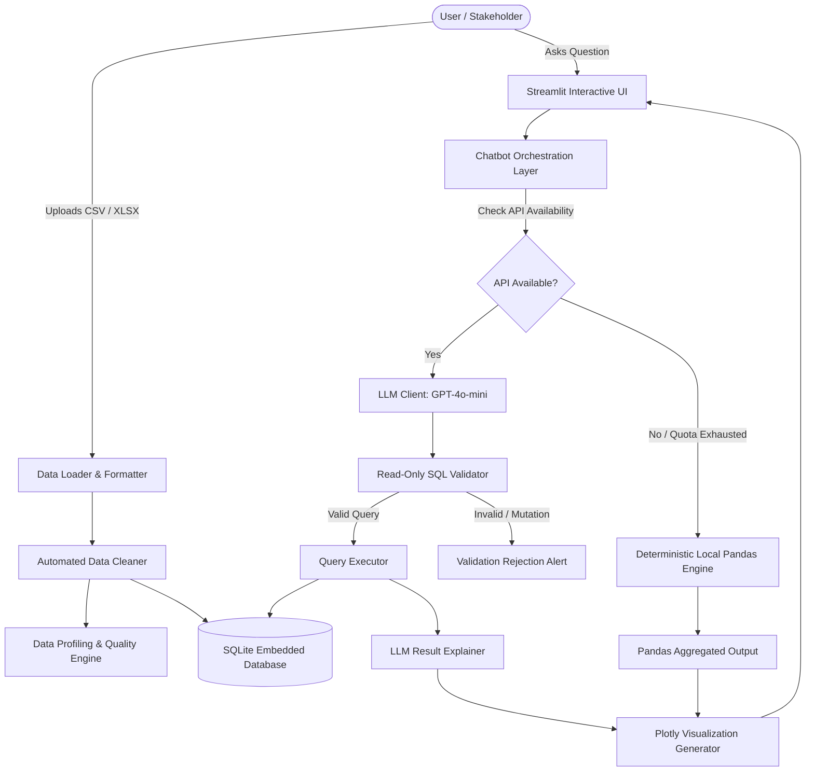

# PROJECT SYNOPSIS

## 1. PROJECT IDENTIFICATION
- **Project Title:** Data Analyst AI Chatbot: Intelligent Tabular Data Analytics with Dual-Engine Natural Language Querying
- **Project ID:** P_123
- **Suggested Repository Names:**
  - `data-analyst-ai-chatbot` *(Recommended - clean, direct, descriptive)*
  - `smart-data-analyst-ai`
  - `ai-tabular-data-analyst`
  - `nl-sql-data-analyst`
- **GitHub Repository URL:** https://github.com/atishkr25/data-analyst-ai-chatbot
- **Domain:** Artificial Intelligence, Natural Language Processing (NLP), Business Intelligence (BI), Automated Data Analytics
- **Primary Technologies:** Python, Streamlit, Pandas, SQLite, OpenAI GPT API, Plotly, SQLParse, Pytest

---

## 2. ABSTRACT / EXECUTIVE SUMMARY
In modern enterprise environments, rapid data-driven decision making is critical; however, non-technical stakeholders often encounter significant barriers when attempting to extract insights from raw datasets (CSV, Excel). Standard workflows require technical proficiency in SQL, Python, or complex BI tools, frequently creating operational bottlenecks for data engineering teams.

**Data Analyst AI Chatbot** is a full-stack, portfolio-ready business intelligence application that bridges the gap between natural language questions and relational data querying. Users upload structured datasets (CSV, XLS, XLSX), which are automatically sanitized, profiled, and loaded into an in-memory or embedded SQLite database. The system features a robust **dual-engine execution pipeline**:
1. **AI + SQL Mode:** Leverages Large Language Models (LLMs) to dynamically convert conversational business questions into structured SQLite queries, executes them against the sanitized database, and provides both tabular results and automated natural-language explanations.
2. **Local Fallback Mode:** Employs a deterministic Pandas calculation engine that transparently handles foundational analytical operations (e.g., aggregations, group-bys, min/max, value filtering) when API keys are absent, quota limits are reached, or network connectivity is severed.

To ensure enterprise-grade safety, the platform enforces an AST-based SQL validation layer that permits only single read-only `SELECT` / CTE statements, preempting SQL injection and data tampering. Coupled with dynamic Plotly visualizations and an interactive multi-tab Streamlit dashboard, this project democratizes data exploration while guaranteeing security, resilience, and actionable insight delivery.

---

## 3. PROBLEM STATEMENT
Organizations routinely accumulate structured data in spreadsheets and CSV exports. Despite the ubiquity of this data, business stakeholders struggle to extract timely insights due to:
1. **Technical Barrier to Querying:** Non-technical managers and business analysts lack fluency in SQL syntax, database normalization, and query tuning.
2. **Data Hygiene & Cleansing Overhead:** Raw tabular uploads often contain corrupted headers, missing values, inconsistent data types, and formatting quirks that break standard analytics workflows.
3. **API Brittleness & Cost Escalation:** Purely cloud-dependent AI tools fail when network partitions occur or API token quotas expire, disrupting mission-critical analytical workflows.
4. **Security Vulnerabilities in Automated SQL Execution:** Allowing an LLM to generate executable database code poses severe risks of SQL injection or unintended destructive mutations (`DROP`, `DELETE`, `UPDATE`, `ALTER`).

---

## 4. OBJECTIVES OF THE PROJECT
- **Democratize Data Access:** Enable non-technical users to converse with structured datasets using intuitive natural language.
- **Automated Data Preparation:** Automatically clean, cast, profile, and index raw tabular datasets into an optimized relational SQLite database.
- **Zero-Trust SQL Execution:** Implement an AST-based parser to inspect and enforce read-only execution constraints, blocking all destructive or multi-statement payloads.
- **Fail-Safe Offline Resilience:** Architect a dual-engine fallback that seamlessly routes analytical queries to local Pandas operations if LLM endpoints are unreachable.
- **Automated Visual Analytics:** Provide on-the-fly chart generation (bar charts, line graphs, scatter plots) and executive-level result explanations without manual plotting setup.

---

## 5. SYSTEM ARCHITECTURE & DATA FLOW

### System Architecture Diagram

---

## 6. KEY FUNCTIONAL MODULES

| Module Name | File Path | Core Functionality |
| :--- | :--- | :--- |
| **Data Ingestion** | `src/data_loader.py` | Validates file extensions (`.csv`, `.xlsx`, `.xls`), handles encoding detection, and parses files into memory. |
| **Data Cleaning** | `src/data_cleaner.py` | Strips whitespace, normalizes column names, infers numeric/date types, and handles missing/null values. |
| **Data Profiler** | `src/data_profiler.py` | Computes column cardinality, null percentages, memory footprint, and categorical distributions. |
| **Database Manager** | `src/database.py` | Dynamically maps cleaned DataFrames into SQLite tables and extracts database schemas for LLM prompts. |
| **SQL Security Validator** | `src/sql_validator.py` | Uses `sqlparse` AST parsing to block multi-statement payloads and destructive commands (`DROP`, `ALTER`, `UPDATE`, `DELETE`, etc.). |
| **Query Executor** | `src/query_executor.py` | Executes approved SQL statements with timing metrics and converts SQLite records back to DataFrames. |
| **Local Fallback Engine** | `src/local_fallback.py` | Employs regex pattern matching to resolve aggregations (`SUM`, `AVG`, `COUNT`, `MIN`, `MAX`, `GROUP BY`) locally with Pandas. |
| **LLM Interface** | `src/llm_client.py` | Builds schema-aware prompts, interfaces with OpenAI APIs, and generates post-query natural language explanations. |
| **Visualization Engine** | `src/visualization.py` | Detects data shapes (continuous vs. discrete) and automatically plots interactive Plotly graphs. |
| **User Interface** | `app.py` | Interactive multi-view Streamlit portal featuring Dataset Explorer, KPI Dashboards, SQL Terminal, and Chatbot. |

---

## 7. TECHNOLOGY STACK

- **Frontend & App Framework:** Streamlit (v1.37+)
- **Core Programming Language:** Python 3.10+ / 3.12+
- **Data Manipulation & Analysis:** Pandas (v2.2+), NumPy (v1.26+), openpyxl, xlrd
- **Relational Storage:** SQLite3 (Embedded Serverless Relational Database)
- **Generative AI & LLM Integration:** OpenAI API (`gpt-4o-mini` / `gpt-4o`), `python-dotenv`
- **SQL Parsing & Security:** `sqlparse` (AST-based statement validator)
- **Data Visualization:** Plotly Express & Plotly Graph Objects
- **Testing & Verification:** Pytest (Unit tests for cleaner, loader, query executor, and local fallback)

---

## 8. SECURITY & GOVERNANCE MEASURES
1. **Read-Only Sandboxing:** The database is accessed with strict query validation. Only single-statement `SELECT` and `WITH ... SELECT` queries are allowed to run.
2. **Destructive Command Blocker:** SQL keywords such as `DROP`, `DELETE`, `UPDATE`, `INSERT`, `ALTER`, `CREATE`, `RENAME`, `TRUNCATE`, and comment injections (`--`, `/*`) are immediately intercepted and rejected.
3. **Environment Security:** Sensitive API credentials are never hardcoded. All keys are retrieved via environment variables declared in `.env` (which is excluded from source control via `.gitignore`).
4. **Data Isolation:** User datasets are stored locally in isolated SQLite instances, ensuring zero unauthorized cross-session data persistence.

---

## 9. FUTURE SCOPE & ROADMAP
- **Multi-Table Relational Joins:** Enable multi-file uploads with automatic entity-relationship detection and foreign key join generation.
- **Local Open-Source LLM Integration:** Support on-premises models via Ollama / LLaMA-CPP to guarantee 100% offline and air-gapped deployments.
- **Automated Report Generation:** One-click export of data audit reports in PDF and Microsoft Word formats with embedded figures.
- **Advanced Anomaly Detection:** Machine learning-based outlier and pattern detection for time-series tabular data.
